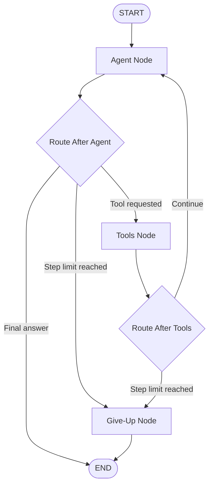

# Week 7 - LangGraph Agent Loop Notes

## Part A - Agent Fundamentals and LangGraph Core

### 1. Chatbot vs Chain vs Agent

A chatbot mainly responds to user messages.

A chain follows a predefined sequence of steps. The path is mostly fixed before execution.

An agent can decide what action to take next based on the current state and previous observations. It can select tools, observe their results, make another decision, and continue until the task is complete or a termination condition is reached.

---

## 2. Think - Act - Observe Loop

The Week 7 demonstration implements the following agent pattern:

1. **Think** - The agent examines the current message or tool observation and decides what to do.
2. **Act** - The agent requests a tool.
3. **Observe** - The tool result is returned to the graph as a `ToolMessage`.
4. **Think Again** - The agent uses the observation to decide whether another tool is needed or whether it can answer the user.
5. **Terminate** - The graph reaches `END` when the task is complete or routes to `give_up` when the hard step limit is reached.

---

## 3. LangGraph State

The demonstration uses an `AgentState` containing:

- `messages` - conversation and tool messages accumulated during execution.
- `step_count` - number of agent decision steps executed.
- `status` - current/final execution status.

The messages field uses an append reducer so new messages are added to the existing message history instead of replacing it.

---

## 4. Graph Nodes

The graph contains three main nodes.

### agent

The `agent` node examines the current state and decides whether to:

- search the catalog,
- check book availability,
- run the failure-test tool,
- produce a final answer.

### tools

The `tools` node executes the tool requested by the agent.

Tool results are returned as `ToolMessage` observations.

Tool exceptions are caught and converted into `ToolMessage` results so that a tool failure does not crash the complete graph.

### give_up

The `give_up` node safely terminates execution when the maximum number of allowed agent steps has been reached.

---

## 5. Conditional Routing

After the `agent` node, routing checks:

- whether `MAX_STEPS` has been reached,
- whether the agent requested a tool,
- whether the agent has produced a final answer.

After the `tools` node, the graph either:

- returns to the agent for another decision, or
- routes to `give_up` when the hard step limit has been reached.

---

## 6. Graph Diagram



The Mermaid diagram represents the same control flow implemented by the LangGraph `StateGraph`.

---

## 7. Normal Agent Loop Experiment

### User Request

> Find me a science-fiction book that is available.

### Observed Execution

The graph performed the following sequence:

1. The agent requested `search_catalog`.
2. `search_catalog` returned:
   - Dune - available
   - Neuromancer - unavailable
3. The agent selected Dune and requested `check_availability`.
4. `check_availability` confirmed that Dune was available.
5. The agent produced the final answer.

### Result

- Status: `completed`
- Agent steps: `3`
- Selected book: `Dune`

The observed flow was:

```text
User
  -> Agent
  -> search_catalog
  -> Observation
  -> Agent
  -> check_availability
  -> Observation
  -> Agent
  -> Final Answer
  -> END
```

---

## 8. MAX_STEPS Experiment

The normal configuration uses:

```python
MAX_STEPS = 6
```

For the termination experiment, it was temporarily changed to:

```python
MAX_STEPS = 2
```

### Observed Result

- Status: `gave_up`
- Steps: `2`

The agent successfully searched the catalog and then requested `check_availability`.

However, the hard step limit was reached before the availability tool was executed. The graph therefore routed to the `give_up` node.

The final user-facing message was:

> I could not complete the request within the allowed number of steps.

### User Experience

The user does not receive the requested final availability result when the limit is too small. However, the system terminates predictably and provides a clear message instead of continuing indefinitely.

After this experiment, `MAX_STEPS` was restored to `6`.

---

## 9. Why a Hard Termination Condition Is Required

An autonomous agent can repeatedly call tools or continue making decisions.

Without a termination condition, a faulty decision path, repeated tool failure, or circular reasoning could cause an uncontrolled loop.

The hard `MAX_STEPS` limit provides a final safety boundary even if normal completion logic fails.

---

## 10. Always-Failing Tool Challenge

A demonstration tool named `failing_library_tool` was added.

The tool intentionally raises:

```text
RuntimeError: Simulated library service failure.
```

### Prediction Before Running

The expected behavior was:

```text
User
  -> Agent
  -> failing_library_tool
  -> Tool failure
  -> Failure returned as observation
  -> Agent
  -> Safe final response
  -> END
```

The expected result was that Python and the LangGraph execution would not crash.

### Actual Result

The experiment produced:

- Status: `completed_with_tool_error`
- Steps: `2`

The tool observation was:

> Tool execution failed: Simulated library service failure.

The agent then responded:

> The library tool failed, so I could not complete that operation safely. Please try again later.

### Conclusion

The prediction matched the observed result.

The tool exception was caught inside the tool-execution node and converted into a `ToolMessage`. This allowed the agent to observe the failure and terminate with a controlled response instead of crashing the graph.

---

## 11. Normal Path Regression Check

After adding the failing-tool challenge, the normal science-fiction scenario was run again.

It still produced:

- Status: `completed`
- Steps: `3`
- Available book: `Dune`

This confirmed that adding failure handling did not break the normal agent path.

---

## 12. Key Lessons

The Part A implementation demonstrated that:

- an agent differs from a fixed chain because it can choose its next action,
- LangGraph state carries information between nodes,
- reducers preserve accumulated message history,
- nodes perform individual responsibilities,
- conditional edges determine the next execution path,
- tool results become observations for the agent,
- tool exceptions should be handled instead of crashing the graph,
- autonomous loops require a hard termination condition,
- `MAX_STEPS` provides a safety boundary,
- a `give_up` node provides controlled termination when the limit is reached.

The final Part A implementation therefore supports normal completion, controlled tool failure, and hard step-limit termination.